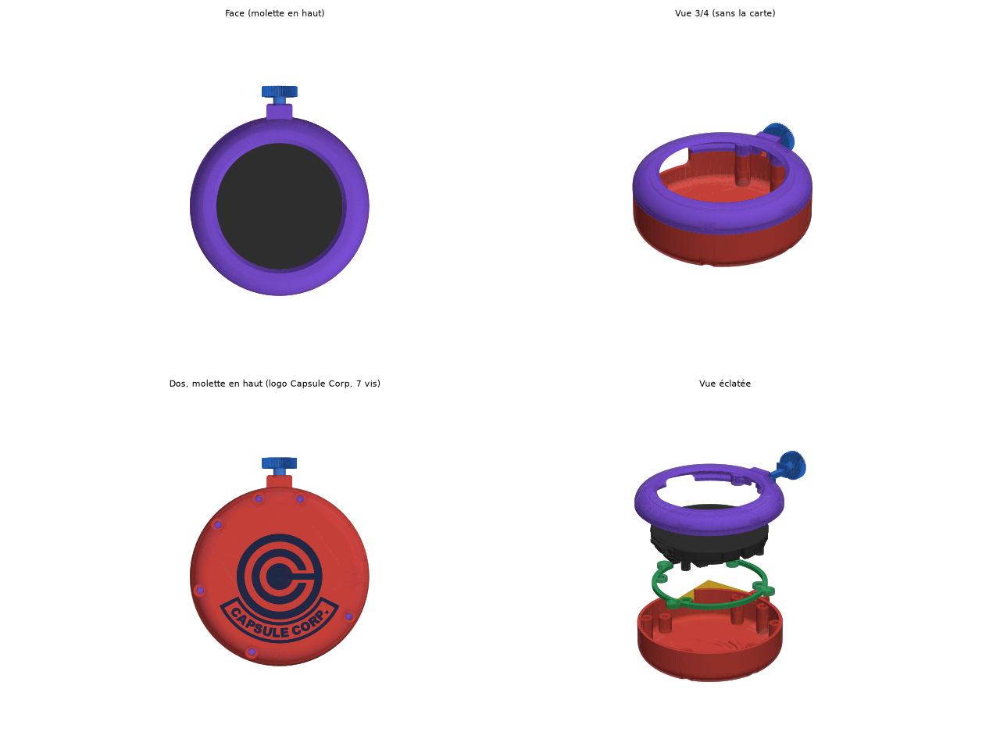
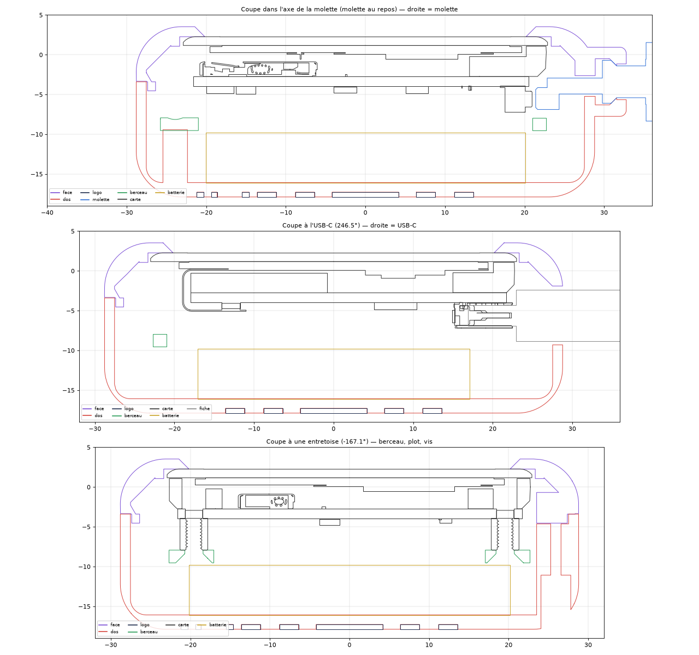

# Dragon Radar

A working Dragon Ball **Dragon Radar**: a 3D-printed case around a round 1.43" AMOLED that shows
the aircraft flying around you in real time (ADS-B), runs on a LiPo, and uses the crown on top as
its only button.



This repository is a fork of **[socquique/capsule-radar](https://github.com/socquique/capsule-radar)**
by Quique Tortosa, the live ADS-B radar firmware (MIT). The firmware is the same apart from the
crown button described below; everything else the radar does (web configuration, themes, weather
views, OTA…) is documented in [docs/CAPSULE_RADAR.md](docs/CAPSULE_RADAR.md), the upstream README.

The enclosure is a remix of the **[Dragon Ball Radar](https://makerworld.com/models/2776400)** model
on MakerWorld: scaled to the Waveshare 1.43" board, made thicker to hold a battery under the board,
and fitted with a crown that really presses a button.

## What this fork adds

The crown presses the board's **BOOT button** (GPIO0):

- **Short press**: next zoom step (10 → 20 → 30 → 50 → 100 km), like the on-screen zoom button.
  On a dark or idle screen, the press only wakes it.
- **Hold 2 s**: a red ring fills around the screen; let go and the radar goes into deep sleep
  (screen and WiFi off).
- **Wake up**: hold the crown 1.5 s. A short bump sends it straight back to sleep.

Firmware version `1.6.0-dragon.1`, shown on the Stats screen and on the web page. Timings are the
`BOOT_BTN_*` values in `src/config.h`; the button logic is in `src/boot_button.h` and has host tests
in `tests/boot_button_test.cpp`.

## Hardware

| Part | Notes |
| --- | --- |
| [Waveshare ESP32-S3-Touch-AMOLED-1.43](https://www.waveshare.com/esp32-s3-touch-amoled-1.43.htm) | the bare board (not the -B version with a case, not the 1.75) |
| LiPo 603040, 3.7 V, about 800 mAh | 6 × 30 × 40 mm, 2-pin 1.25 mm connector — check the polarity |
| 4 × M2×5 countersunk | board → cradle, into the board's brass standoffs |
| 3 × M2×6 countersunk | cradle → posts in the back shell |
| 6 × M2×10, pan or cap head | closes the case, from the back |
| PLA for the body + PLA in a second colour | the Capsule Corp logo is a two-colour inlay |
| PETG (optional) | support interface under the front lip |

Finished size: Ø 57.6 × 21.4 mm.

## Printing

Everything is in [`hardware/dragon-radar-1.43/`](hardware/dragon-radar-1.43/):

- `dragon-radar-1.43.3mf`: Bambu Studio project (X2D, 0.4 mm nozzle, 0.20 mm layers, textured PEI
  plate), every part on one plate, about 1 h 20. Filament 1 is the body, filament 2 the logo.
- `stl/` and `step/`: each part on its own.

| File | Part |
| --- | --- |
| `face` | front bezel (holds the glass under its lip) |
| `dos` | back shell |
| `logo` | Capsule Corp inlay of the back shell (second colour) |
| `molette` | crown |
| `berceau` | cradle the board is screwed to |
| `support_pied`, `support_berceau` | display stand |

Tips:

- **Print the front lip-up**, as in the 3MF. Do not flip it: lying on its face, the whole visible
  dome becomes an overhang and gets covered in supports.
- Supports are only needed under the lip, on the ledge the glass rests on (hidden by the screen).
  Print them in the body filament with a 0.2 mm gap, or use PETG for the support interface
  (top Z distance 0): PLA and PETG don't stick to each other, so it peels off cleanly.
- The logo is a 0.6 mm inlay in the first three layers of the back shell. With a single colour,
  delete the `logo` part: it stays as an engraving.
- Print the crown wheel-down.

## Assembly



1. Screw the board onto the cradle: 4 × M2×5 countersunk, from below.
2. Stick the battery to the floor of the back shell with double-sided tape.
3. Check the battery connector's polarity with a multimeter (pin order varies between sellers),
   then plug it into BAT. The plug goes in from the centre side of the board.
4. Lay the cradle on the three posts and screw it down: 3 × M2×6 countersunk.
5. Drop the crown in: the square flange goes into the square half-pocket, the flat blade into its slot.
6. Close with the front (the crown is trapped between the two halves) and drive the 6 × M2×10 from
   the back. The cradle posts are 0.1 mm proud on purpose, so the glass is pressed under the lip.

With the crown on top, the USB-C port sits at about 10 o'clock, so the radar charges on its stand.

## Firmware

### Update over the air (board already running Capsule Radar)

1. Download `dragon-radar-1.6.0-dragon.1-amoled143-ota.bin` from the
   [Releases](https://github.com/BaQs/dragon-radar/releases).
2. Open the radar's web page (`http://capsuleradar.local`, or the address shown on the Stats
   screen) and follow **Firmware update**.
3. Upload the file. The radar restarts and shows `v1.6.0-dragon.1`.

### First install over USB

With [PlatformIO](https://platformio.org/): `pio run -e esp32-s3-amoled-143 -t upload`.
You can also flash upstream Capsule Radar with its web flasher, then update over the air as above.

### Settings for this case

- **Screen rotation**: the board sits turned 66.5° in the case so that BOOT faces the crown. On the
  web page, *Screen rotation* = 335° gives an upright picture with the crown on top (try 336 or 337
  if the grid looks slightly tilted).
- **No power switch**: the 1.43 board has no PMIC. In deep sleep its power LED stays on and slowly
  drains the battery.
- Holding the crown while plugging in USB or pressing reset starts the board in download mode
  (BOOT is GPIO0): let go and reset.

### Build

```
pio run -e esp32-s3-amoled-143      # firmware for the 1.43 board
./tests/run_host_tests.sh           # host tests, including the crown button logic
```

## Regenerating the enclosure

The scripts in [`tools/dragon-radar/`](tools/dragon-radar/) rebuild every part (Python 3.12 with
build123d, trimesh and manifold3d):

```
python build_radar143.py <radar STEP> <stand STEP> <Waveshare 1.43 STEP> <output folder>
python checks.py <output folder>      # no part touches the board, the battery or a USB-C plug
python make_3mf.py <output folder> <file.3mf> [Bambu project to copy the printer settings from]
```

The inputs are not in this repository: the radar and stand STEP files come with the original
MakerWorld model, and the board model is on the Waveshare wiki. Every dimension the scripts use
(scale, clearances, battery, crown travel, screws…) is in the `P` table at the top of
`build_radar143.py`.

## Credits and licences

- Firmware: [Capsule Radar](https://github.com/socquique/capsule-radar) by Quique Tortosa (socquique),
  MIT licence (see [LICENSE](LICENSE)). The changes in this fork are under the same licence.
- Enclosure: remix of [Dragon Ball Radar](https://makerworld.com/models/2776400) on MakerWorld,
  credit to its author; check the original model's licence there before reusing these files.
- The Capsule Corp emblem was redrawn for this project.
- Dragon Ball, the Dragon Radar and Capsule Corporation are trademarks of their respective owners.
  This is a non-commercial fan project.
